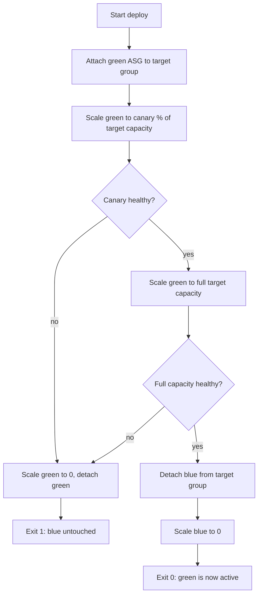

# ASG blue/green and canary deploy framework

A small Bash framework for blue/green deploys of two EC2 Auto Scaling Groups
(ASGs) sharing one Application Load Balancer target group, with a canary
step and an automated health-check gate.

## Problem

Write a robust Bash framework (with logging, error handling, dry-run mode)
for performing blue/green or canary deployments of EC2 Auto Scaling Groups.

## Scope and design choice

There are several valid ways to implement a blue/green ASG swap (swapping
which ASG a listener rule points at, swapping target groups on a listener,
or attaching/detaching ASGs from a shared target group). This project
picked the simplest honest option: **one target group shared by both ASGs**.
The "blue" ASG starts attached and serving traffic; the "green" ASG starts
detached. Cutover is attach-green / detach-blue, not a listener rewrite.
Listener-rule swapping is out of scope.

## Flow



## Usage

```sh
# Dry run (default): logs every AWS call it would make, makes none of them.
./scripts/deploy.sh \
  --blue-asg my-app-blue --green-asg my-app-green \
  --target-group-arn arn:aws:elasticloadbalancing:us-east-1:123456789012:targetgroup/my-app/abc123 \
  --target-capacity 10

# Apply: actually attach/detach/scale.
./scripts/deploy.sh \
  --blue-asg my-app-blue --green-asg my-app-green \
  --target-group-arn arn:aws:elasticloadbalancing:us-east-1:123456789012:targetgroup/my-app/abc123 \
  --target-capacity 10 \
  --canary-percent 20 \
  --health-check-attempts 10 --health-check-interval 15 \
  --apply
```

Flags:

| Flag | Default | Meaning |
|---|---|---|
| `--blue-asg` | required | name of the currently active ASG |
| `--green-asg` | required | name of the ASG to cut over to |
| `--target-group-arn` | required | shared ALB/NLB target group ARN |
| `--target-capacity` | required | desired capacity once green is fully active |
| `--canary-percent` | `20` | percent of target capacity to run as the canary step |
| `--health-check-attempts` | `5` | polling attempts per health gate |
| `--health-check-interval` | `5` | seconds between polling attempts |
| `--apply` | off | actually make changes (mutating AWS calls) |
| `--dry-run` | **on by default** | log what would run, make no mutating calls |

**Dry-run is the default.** Without `--apply`, every mutating call
(`attach-load-balancer-target-groups`, `update-auto-scaling-group`,
`detach-load-balancer-target-groups`) is only logged, never executed, and
health checks are skipped entirely and assumed to pass. A dry run makes
zero AWS API calls.

## Rollback behavior

If the canary health check fails, the green ASG is scaled to 0 and
detached. Blue is never touched, so the failure is a no-op from the load
balancer's point of view. If the canary passes but the *full-capacity*
health check after scaling green up fails, the same rollback runs before
blue is ever detached — blue keeps serving traffic the whole time. Blue is
only detached and scaled down after green has proven healthy at full
target capacity.

## Idempotency

Re-running the script after a successful cutover is safe: green is already
attached and at target capacity, blue is already at 0, so the canary and
cutover steps just re-assert the same state. Re-running after a rollback
is also safe: it retries the canary from scratch.

## Security notes

This script issues read-only `describe-target-health` calls and mutating
`autoscaling`/`elbv2` calls. In dry-run mode (the default) it needs no AWS
credentials at all — `aws` is never invoked. To run `--apply` against a
real account, the minimum IAM policy would need:

- `autoscaling:UpdateAutoScalingGroup`
- `autoscaling:AttachLoadBalancerTargetGroups`
- `autoscaling:DetachLoadBalancerTargetGroups`
- `elasticloadbalancing:DescribeTargetHealth`

No secrets or credentials are stored or required by this repository itself.

## Validation level

- **Tested:** all deploy logic (canary gate, rollback on canary failure,
  rollback on cutover failure, full cutover, dry-run making zero calls,
  argument validation) against a fake `aws` CLI script
  (`tests/fakebin/aws`) that records every invocation to a log file and
  returns scripted health-check results. See `tests/run_tests.sh`. Every
  bash file is also linted with `shellcheck`.
- **Not tested:** this has never been run against a real AWS account, ASG,
  or target group. There is no integration test against live AWS APIs.
- The test runner is a small hand-rolled script rather than bats-core,
  since the test matrix is small (five cases) and a hand-rolled runner
  keeps the dependency list at zero for both local runs and CI.

## Running tests locally

```sh
bash tests/run_tests.sh
shellcheck scripts/deploy.sh lib/*.sh tests/run_tests.sh tests/fakebin/aws
```
